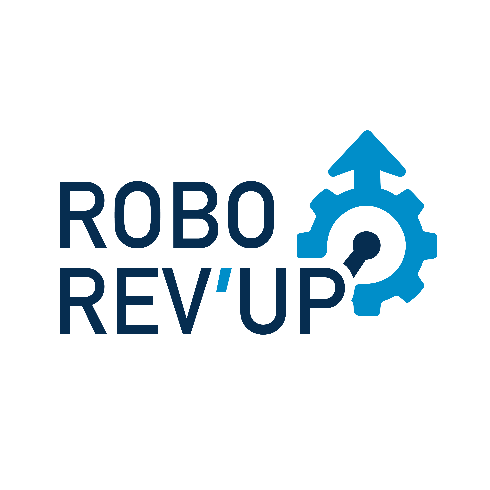

Our graduate students volunteer their time to support the university's student robotics clubs. We mentor the VAMUdeS and RobotiqueUdeS (Rovus and Arcus) clubs, which compete in student drone, rover, and autonomous race car competitions, respectively.

  

  

  

More information is available at [robotiqueudes.ca](https://robotiqueudes.ca).
